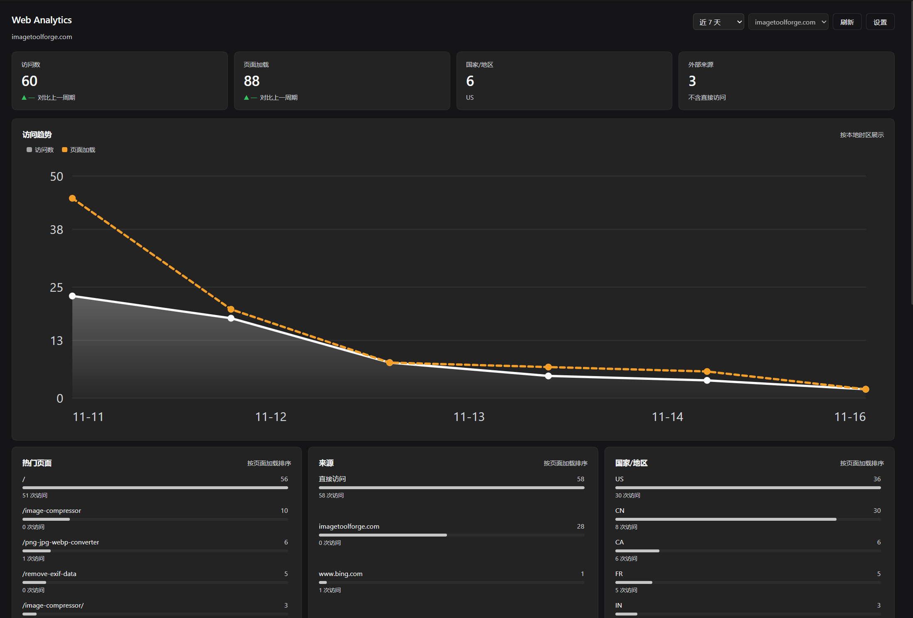

# Cloudflare 看板插件（dsh-cloudflare-dash）

DeepSeek Harness（DSH）插件：在侧边栏加一个 Cloudflare 面板，通过 Cloudflare 官方 API 展示 Web Analytics 数据。

> 非 Cloudflare 官方产品。Cloudflare 是 Cloudflare, Inc. 的商标，本项目与 Cloudflare 不存在隶属或背书关系。

> 当前状态：**M4 — Agent 工具**。看板（概览、趋势、维度、Core Web Vitals、加载性能、缓存与自动刷新）已完成；另提供一个按需调用的 agent 工具 `cloudflare_analytics`，未配置 Token 时不会出现在任何 agent 的工具列表里。



## 安装

需要 **DSH ≥ 0.2.2-rc.3**（见 `package.json` 的 `engines.dsh`）。插件自带构建好的客户端产物，**不需要 Node、pnpm 或任何构建步骤**。

**方式一：下载 ZIP**

1. 本仓库页 → `Code` → `Download ZIP`，解压到一个**固定位置**（不要放临时目录或下载文件夹，原因见下）。
2. DSH → **Plugins** → **Add plugin** → 选中解压出来的目录。
3. 刷新页面，侧边栏出现柱状图标。

**方式二：git clone**（便于更新）

```bash
git clone https://github.com/north30-dev/dsh-cloudflare-dash.git
```

之后同样用 **Add plugin** 选中该目录。更新时 `git pull`，然后重启 DSH（或先移除再重新 Add）。

> 安装是**链接**到该目录，不是复制：移动或删除这个目录会让插件失效。卸载请用 Plugins 里的移除，不要直接删目录。

## 快速开始

1. 在 Cloudflare 后台创建 **只读** API Token：<https://dash.cloudflare.com/profile/api-tokens>
   - 用 **Create Custom Token**（不要用「账户 API 令牌」，除非你知道自己在做什么，见下方说明）
   - 权限（Cloudflare 后台里的英文名，**只有这两项，没有 Web Analytics 这个权限**）：
     - `Account Settings:Read` —— 列出账户 + 读取 Web Analytics 站点列表（Cloudflare 官方文档中 `rum/site_info/list` 要求的权限就是它）
     - `Account Analytics:Read` —— 读取分析数据（M2 起使用）
   - Account Resources 选你自己的账户即可；只勾 Read，不要给 Edit
2. 点侧边栏的柱状图标 → 粘贴 Token → 「验证并保存」。
3. 看到「✅ 验证通过：N 个账户 / M 个 Web Analytics 站点」即配置完成。

### 两种令牌

| 你创建的位置 | 面板里怎么填 |
|---|---|
| **Profile → API Tokens**（用户级，40 位字符） | 只填 Token，Account ID 留空 |
| **Manage Account → Account API Tokens**（帐户级，值以 `cfat` 开头） | Token + **Account ID**（32 位十六进制，在后台概览页 URL 里） |

帐户级令牌不能用 `/user/tokens/verify` 校验，插件会改用 `/accounts/{id}/tokens/verify`；没填 Account ID 时会在报错里提示。

Token 保存在 DSH 凭据库（`~/.credentials.yaml` 的记录 `dsh-cloudflare-dash/api-token`），Account ID 是非机密，保存在 `$DSH_HOME/cloudflare-dash/state.json`。两者都不会写入仓库、不会进入会话上下文、不会回传浏览器。

### 验证失败？“Invalid API Token”

按顺序排查：

1. **复制的是 Token ID，不是 Token 值**。Token ID 是 32 位十六进制串，Token 值只在创建完成时显示一次。面板现在会在输入框下方直接警告这种输入。
2. **没复制完整**。用户级 API Token 是 40 位字符；长度不对时 Cloudflare 返回的是 `400 Invalid request headers`（错误码 6003）而不是 401，插件已把它翻译成可读提示。
3. **创建流程没走完**。必须点 `Continue to summary` → `Create Token`；中途关掉页面不会生成可用 Token。
4. **用了 Global API Key**。本插件只支持 API Token；Global API Key 是 37 位十六进制串，面板同样会提示。
5. **用了「帐户 API 令牌」却没填 Account ID**。这类令牌过不了用户级校验接口，必须填 Account ID 走账户级校验。

## 权限与隐私

- 插件代码只实现**只读**的 Cloudflare 请求：`/user/tokens/verify`、`/accounts/{id}/tokens/verify`、`/accounts`、`/accounts/{id}/rum/site_info/list`、GraphQL `viewer` 查询。
- 无遥测、无第三方上报；请求只发往 `api.cloudflare.com`。
- Token 只在 Host 侧使用；浏览器只拿到「已配置 + 掩码」。
- 也可以改用它支持的备用来源：启动环境变量 `CLOUDFLARE_API_TOKEN`（优先级低于 UI 保存的记录）。
- 发现安全问题请**私下**报告，不要开公开 issue，方式见 [`SECURITY.md`](SECURITY.md)。

## 代理

面板里可开启 HTTP 代理（`http://host:port`，CONNECT 隧道），用于直连 Cloudflare API 不稳定的网络。设置存在浏览器 localStorage，属于非机密偏好；代理地址会随每次请求传给 Host，同时写入 `state.json`，这样 agent 工具与看板走同一条网络路径。

「网络诊断」会分别测一次直连与代理的 DNS / TLS / TTFB / 总耗时，方便判断要不要开代理。

## Agent 工具

插件注册**一个**工具 `cloudflare_analytics`（不是每个视图一个，避免每步都塞满工具定义）：

| `action` | 作用 |
|---|---|
| `overview` | 流量总量与环比、逐桶访问、六类 Top 榜、Core Web Vitals、加载阶段耗时；可传 `site`（站点 tag 或域名）、`range`（24h/7d/30d）、`fresh`（跳过缓存） |
| `sites` | 列出账户下的 Web Analytics 站点与 siteTag |
| `status` | 只报告 Token/Account ID/代理是否就绪，不访问 Cloudflare |

- **不注入上下文**：工具返回的是一段紧凑文本报告，只有真被调用时才产生数据；不调用就什么都不占。
- **未配置时不可见**：没有 Token 的 profile 里，这个工具不会出现在任何 agent 的工具列表（Host 用 `tools.register` 的 `when` 条件做门控，30 秒内自适应变化）。
- **只读**：与看板走同一套 GET / GraphQL query，没有任何写操作。
- 详细报告与图表仍在侧边栏面板里；工具报告末尾会提示这一点。

## 目录结构

```
index.js                 # Host 入口（re-export src/host）
src/host/index.js        # 插件 apply：注册 HTTP 路由与 agent 工具
src/host/routes.js       # /cloudflare-dash/api/v1/* 路由与请求栅栏
src/host/cloudflare.js   # Cloudflare API 客户端（只读）
src/host/analytics.js    # RUM GraphQL 查询与数据整形（含 TTL 缓存）
src/host/tool.js         # agent 工具 cloudflare_analytics
src/host/http.js         # 直连/代理出网与阶段计时（零第三方依赖）
src/host/store.js        # 凭据读写与 Token 掩码
src/host/state.js        # 非机密状态：Account ID、代理偏好
src/client/index.jsx     # 注册侧边栏图标与主面板
src/client/app.jsx       # 配置页 / 已配置页
src/client/locale.js     # 中英文案
src/client/styles.css    # 只用 --dsw-alias-* 主题 token
dist/client.js           # 构建产物（已提交，安装即用）
scripts/build-client.mjs # esbuild 打包
assets/                  # 市场图标与截图
screenshots.json         # 市场截图声明（路径相对本文件）
```

## 开发

```bash
pnpm install --allow-build=esbuild   # 首次
pnpm run build                       # 生成 dist/client.js
node scripts/check-manifest.mjs      # 包名 / 补丁行 / bundle id / files 是否一致
node tests/slice-window.mjs          # 纯函数断言（不联网）
```

改客户端代码后必须重新 `pnpm run build`，然后在 DSH 里刷新页面；Host 侧改动通常需要重启 DSH（或依赖 HMR）。

`dist/client.js` 是提交进仓库的产物：这样用户克隆后无需 Node 工具链即可安装。提交前请重新构建，避免产物与源码不一致——CI 会重新构建并对比 `dist/client.js`，不一致就失败。

包名一共出现在三处：`package.json` 的 `name`、`cordis.patch.yml` 的行 `name`、`dist/client.js` 里的 loader `id`。改名必须三处一起改并重新构建，`check-manifest` 就是用来拦这个的。

## 路线图

- ✅ M1 配置闭环（Token UI、校验、代理、诊断）
- ✅ M2 概览首屏：站点选择、24h/7d/30d、访问趋势曲线、热门页面/来源/国家/浏览器、Core Web Vitals（P75 + 分布）
- ✅ M3 缓存与后台刷新（60s 轮询 + Host TTL 缓存）、设备/操作系统维度、加载性能阶段分解（DNS/TCP/TLS/请求/响应/渲染/首绘）
- ✅ M4 单个聚合 agent 工具 `cloudflare_analytics`（`action` 参数，未配置时不可见，按需调用）
- ✅ M5 开源准备（`SECURITY.md`、CI、安装章节、市场图标与截图）
- ⬜ 发布：npm 包、GitHub Release、收录到插件目录

## 数据说明

指标来自 Cloudflare **Web Analytics（RUM）** 数据集，已排除 bot 流量：

| 展示项 | 来源 |
|---|---|
| 访问数 | `rumPageloadEventsAdaptiveGroups.sum.visits` |
| 页面加载 | `rumPageloadEventsAdaptiveGroups.count` |
| 热门页面 / 来源 / 国家 / 浏览器 / 设备 / 系统 | 同名维度分组 |
| Core Web Vitals | `rumWebVitalsEventsAdaptiveGroups` 的 good/needs-improvement/poor 与 P75 分位数 |
| 加载性能（DNS/TCP/TLS/请求/响应/渲染/首绘） | `rumPerformanceEventsAdaptiveGroups.quantiles` 的 P75，微秒换算为毫秒 |

**不包含带宽/流量字节**：RUM 数据集没有该指标，官网 Web Analytics 的「Data served」无法等价复现，面板里也没有伪造。时间桶按 UTC 取回、按浏览器本地时区展示。

**采样与 30 天窗口**：Cloudflare 对 RUM 聚合做 ABR 采样，**窗口越长分辨率越低**。一次 30 天的查询实测只回 2 天数据、数值全是 10 的倍数（7 天窗口却有完整 6 天），所以 30d 改为**按 7 天切片查询再合并**：总量、趋势、六类 Top 榜由切片相加（精确），Core Web Vitals 与加载性能的分位数不能相加，仍走整窗查询（可能是采样估计值）。这条规则只影响长窗口，24h / 7d 仍是一次查询。（[官方 sampling 说明](https://developers.cloudflare.com/analytics/graphql-api/sampling/)）

**缓存与刷新**：看板每 60 秒后台刷新一次（标签页不可见时暂停），Host 侧按范围缓存结果（24h 60s / 7d 120s / 30d 300s）；点「刷新」会带 `fresh=1` 绕过缓存。

## 限制

- 只展示 Token 有权访问的账户与站点。
- 未启用 Web Analytics 的站点不会出现在站点列表里（面板会给提示，不报错）。
- 插件依赖 DSH 的 slot 契约（`sidebar.panellist` / `main`），`engines.dsh` 声明了已验证的最小版本。
- License：MIT，见 [`LICENSE`](LICENSE)。
